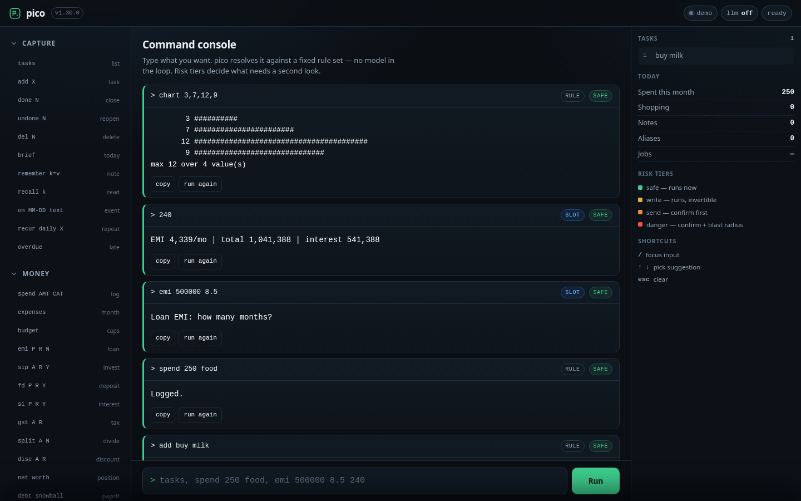

# pico

<p>
  
  
  
  
  
  
</p>

**A personal automation engine that runs on the Python standard library alone.**
109 rules, four risk tiers, universal undo, slot dialogue, replay from snapshots, a trigger DSL,
and an optional language model that is only ever allowed to *propose* a command. No account, no telemetry, no network.

```bash
python3 pico.py tasks                      # one-shot
python3 pico.py spend 250 food             # log an expense
python3 pico.py emi 500000 8.5 240         # EMI 4,339/mo | total 10,41,388
python3 pico.py --ui                       # the console, on 127.0.0.1:8765
```



**[Open the console demo →](https://drsamonline.github.io/pico/app.html)** — the resolver, the risk
gate and every calculation run in the browser; file and network commands need the local engine.

## The thesis

The rule engine is the spine; the model is a plug-in translator. Deleting `packs/llm.py` leaves a
100% offline system with **zero capabilities lost** — only free-form phrasing convenience.

| Claim | How it is enforced | Test |
| --- | --- | --- |
| The model never executes anything | it returns a string; the core matches it against `RULES` before anything runs | T2 |
| A hallucination cannot invent an action | no rule match ⇒ rejected, with a stated reason | T2 |
| Removing the model changes nothing functional | every P0 command produces byte-identical output with the translator present or absent | T1 |
| Privacy domains never leave the device | `never_send` is checked in the **core** resolver, before any translator is called | T8 |
| Every mutation is reversible | handlers register an inverse; `undo` replays them in reverse | T5 |
| Consent is required for sends and deletes | risk gate intercepts, holds state for 120 s | T4 |
| One bad pack cannot take the system down | import and call are both guarded; failures print and continue | T3, T10 |
| One bad command cannot kill the session | every handler is wrapped; the REPL never dies | T3 |

## How a sentence becomes an action

```
rule → alias → typo → fuzzy → teach → [optional LLM] → teach
         ↓
     risk gate → confirm → handler → inverse → ledger
```

| Tier | Cutoff | Deterministic | Example |
| --- | --- | --- | --- |
| rule | exact | yes | `emi 500000 8.5 240` |
| alias | exact, learned | yes | whatever you taught it |
| typo | 0.80 on the first token | yes | `tsks` → `tasks` |
| fuzzy | 0.72 on the catalogue | yes | `srots` → offers candidates |
| llm | provider-dependent | no | off by default |

`dry <cmd>` reports which tier resolved a command, its risk tier, and what it would touch.
`why` prints the last resolution in full. `log` prints the ledger tail.

## Risk tiers

| Tier | Applies to | Behaviour |
| --- | --- | --- |
| `safe` | reads, arithmetic, lists | runs immediately |
| `write` | `tidy`, `backup`, `fill`, `redact`, `dedupe` | runs, records an inverse, `undo` reverses it |
| `send` | `wa`, `mail` | needs `confirm`; expires after 120 s |
| `danger` | `unjob`, `habit del`, `safe delete` | needs `confirm`, previews the affected set |

A `write`-tier command **proposed by the model** is gated like a send. Typed by hand, it runs and
stays undoable. That asymmetry is deliberate: you meant it, the model might not have.

## Commands — 109 rules

| Group | Commands |
| --- | --- |
| Capture | `tasks` · `add X` · `done N` · `undone N` · `del N` · `brief` · `recur daily X` · `due N DATE` · `overdue` · `remember k=v` · `recall k` · `forget k` · `buy X` · `shop` · `bought N` · `on MM-DD text` |
| Money | `spend AMT CAT` · `expenses` · `budget CAT AMT` · `asset NAME AMT` · `debt NAME AMT RATE` · `net worth` · `debt snowball [EXTRA]` · `subs audit` · `emi P R N` · `sip A R Y` · `fd P R Y` · `si P R Y` · `gst A R` · `split A N` · `disc A R` |
| Time | `time` · `timer Nm MSG` · `remind HH:MM MSG` · `calc EXPR` · `convert V U to U` |
| Files | `tidy [PATH]` · `backup PATH` · `find NAME` · `safe delete PATH` · `quarantine` · `restore N` · `quarantine sweep Nd` · `big files` · `old files Nd` · `dedupe files PATH` · `templates` · `fill TPL k=v` · `count PATH` · `extract TYPE PATH` · `sortlines PATH` · `dedupe PATH` · `redact PATH` |
| Life | `habit add X` · `did X` · `habits` · `journal [show N]` · `contact k=v` · `contacts` · `wa NAME MSG` · `mail NAME SUBJ` · `card add Q\|A` · `review` · `grade N` |
| Automation | `daily HH:MM CMD` · `jobs` · `unjob N` · `report weekly` · `decide A\|B` |
| Triggers | `when 22:30 then CMD` · `when every 30m then CMD` · `when file GLOB then CMD` · `when not CMD by HH:MM then CMD` · `when clip matches RE then CMD` · `when SPEC unless away\|weekend\|weekday\|file G\|exists P then CMD` · `watch FOLDER then CMD` · `away on\|off` · `trigger log [N]` · `chain NAME: a ; b` · `for each row in X.csv then CMD` · `triggers` · `untrigger N` |
| Data | `importcsv PATH TABLE` · `sql SELECT …` · `tables` · `csv filter COND PATH` · `csv sort COL[:number\|:text] PATH` · `csv join KEY A B` · `csv pivot COL[,COL] sum AMT PATH` · `chart 1,4,9` |
| Web | `site k=url` · `open X` · `search X` · `weather [city]` |
| Safety | `dry CMD` · `why` · `log` · `undo [N]` · `confirm` · `cancel` · `2key on\|phone` · `approve CODE` · `timeline` · `replay TS` · `aliases` · `unalias P` |
| Model | `llm off\|local\|cloud\|auto` · `llm status` · `llm set K V` · `llm test S` · `llm forget` · `privacy never TAG` |

Full reference with argument shapes: [`docs/COMMANDS.md`](docs/COMMANDS.md).

## Measured

| Property | Value |
| --- | --- |
| dependencies | 0 — Python standard library only |
| rules / catalogue / slot rules | 109 / 113 / 6 |
| packs | 12 |
| python source | 155,687 bytes across 29 files |
| package / packs / console | 84,943 / 70,744 / 70,278 B |
| console | 70,278 bytes, one HTML file, no external assets |
| rule-path latency (read) | 0.45 ms/call empty, 0.88 ms at 1,200 tasks |
| rule-path latency (write) | 1.7 ms empty, 2.3 ms at 1,200 tasks |
| engine heap | 0.1 MB |
| acceptance tests | 340 passing, stdlib `unittest`-free runner |

Reads do a regex match plus one ledger line. Writes also rewrite `state.json`, which is why they cost
more — and why state is only persisted when something actually changed. Both stay inside the 5 ms
budget to roughly 2,000 tasks on the machine these numbers came from; at 5,000 the write reaches
9.5 ms because the whole file is rewritten. An append-only journal is the fix, and it is on the
roadmap. The suite prints its own timings rather than asserting them: a wall-clock bound in a test
measures the CI runner, not the code.

`state.json` is compact JSON. It is still valid and still yours; `python3 -m json.tool ~/.pico/state.json`
prints it indented when you want to read it. Indenting it on every write cost 34 ms at 5,000 tasks —
seven times the compact form — which is why it is not the default. Writes pay for durability twice — `state.json` on
every change and a snapshot every 25 changes so `replay` has a starting point — and still land at
4.03 ms. Making the temp filename thread-unique removed the contention that had cost 1.5 ms.

## Budgets

Growth is allowed; silent growth is not. `budget.json` records the current size of each part, and
`tools/budget.py` fails the build when anything grows past that baseline by more than 10%. A feature
that needs room runs `python tools/budget.py --update` in the same commit, so the diff shows the
decision.

| Part | Baseline | Ceiling (+10%) | Actual |
| --- | --- | --- | --- |
| package (`pico/` + launcher, 18 files) | 84,943 B | 93,437 B | 84,943 B |
| packs (12 files) | 70,744 B | 77,818 B | 70,744 B |
| console (one HTML file) | 70,278 B | 77,305 B | 70,278 B |
| rule-path latency | — | 5 ms | 0.45 ms read, 1.7 ms write empty |
| idle heap | — | 15 MB | 0.1 MB |
| dependencies | — | 0 | 0 |

The package is split by responsibility, so no single file has to be small:

| File | Bytes | Owns |
| --- | --- | --- |
| `pico/engine.py` | 6,004 | composition, plugin loading, notifier bus |
| `pico/cmd_doctor.py` | 8,071 | the self-check and both probes |
| `pico/dispatch.py` | 7,071 | `handle()`, the single entry point |
| `pico/cmd_files.py` | 3,981 | sort, archive, find, fill |
| `pico/cmd_quarantine.py` | 3,570 | delete safety: quarantine, restore, sweep |
| `pico/cmd_repair.py` | 4,159 | `doctor fix` |
| `pico/rules.py` | 5,830 | the pattern table, help, catalogue |
| `pico/store.py` | 5,101 | state, atomic writes, snapshots, replay |
| `pico/ui.py` | 4,502 | the local web server |
| `pico/cmd_tasks.py` | 4,427 | tasks, notes, shopping, events, brief |
| `pico/ledger.py` | 4,081 | execution, inverses, undo |
| `pico/base.py` | 3,883 | constants and pure helpers |
| `pico/ladder.py` | 3,561 | rules, risk tiers, slot dialogue |
| `pico.py` | 2,283 | launcher |
| `pico/cmd_web.py` | 1,528 | shortcuts, open, search, weather |
| `pico/cmd_time.py` | 1,462 | clock, timer, reminder, calc, convert |
| `pico/cmd_money.py` | 868 | the expense log |
| `pico/__init__.py` | 129 | exports |


## Install

```bash
git clone https://github.com/drsamonline/pico
cd pico
sh install.sh            # Linux, macOS, Termux — or: powershell -File install.ps1
python3 ~/pico.py --ui
```

Or run in place with no install: `python3 pico.py --ui`. The console binds `127.0.0.1`, requires the
token in `~/.pico/web.token`, and makes no outbound request. LAN mode is opt-in (`--ui --lan`) and
prints a warning when enabled. On a phone, open the LAN address and use Add to Home Screen.

| Platform | Path |
| --- | --- |
| Linux / macOS | `sh install.sh` |
| Windows | `powershell -File install.ps1`, or the release `.exe` |
| Android | [three routes](docs/ANDROID.md): install the console to the home screen, run pico under Termux, or use the Telegram bridge |
| Any browser | `--ui`, then the printed URL |

One-file binaries for Windows, Linux and macOS are built by
[`.github/workflows/release.yml`](.github/workflows/release.yml) on every tag.

## What it will not do

- **Reason.** No abstractive summarising, translation or open-ended answers without the optional model.
  Phrasing is literal plus learned aliases; it does not *understand* and will say so.
- **Two-way WhatsApp.** `wa` opens a deep link and you press send. Real two-way needs Meta's Cloud API
  and a public webhook; Telegram is the clean route and is supported.
- **Wake itself up.** Timers and daily jobs fire only while pico runs (`--serve` or the REPL).
- **OCR, speech, QR rendering.** Pure stdlib cannot. Those are external tools, and the README of the
  spec says so rather than pretending.
- **Encrypt anything.** State is plain JSON in `~/.pico/`. The ledger redacts the output of `recall`,
  `journal`, `contacts` and `aliases`, and masks values in `remember`/`contact` lines, but the files
  themselves are readable. Use full-disk encryption.

## Layout

```
pico.py                  launcher: REPL, one-shot, --serve, --ui, --version
pico/engine.py           state, resolution ladder, risk gate, ledger, inverses, plugin loader
pico/rules.py            the core rule set
pico/ui.py               local web server (http.server, token-gated)
packs/*.py               drop-in capabilities, deletable one at a time
web/index.html           the console — one file, no external assets
templates/*.txt          {{placeholder}} templates
tests/smoke_test.py      30 acceptance checks
docs/                    landing page, console demo, architecture, commands, roadmap
```

Runtime data lives in `~/.pico/` (`PICO_HOME` overrides it): `state.json`, `ledger.jsonl`, `jobs.json`,
`habits.json`, `life.json`, `llm.json`, `web.token`, `backups/`.

## Where to read next

| | |
| --- | --- |
| [`docs/ARCHITECTURE.md`](docs/ARCHITECTURE.md) | how the engine, ladder, gate and inverses fit together |
| [`docs/COMMANDS.md`](docs/COMMANDS.md) | every command, argument shapes, tiers, examples |
| [`docs/ROADMAP.md`](docs/ROADMAP.md) | what is next, with the exit test for each item |
| [`docs/ANDROID.md`](docs/ANDROID.md) | why there is no APK, and the three routes that work |
| [`tools/demo_parity.py`](tools/demo_parity.py) | checks the console demo against the engine, 145 commands |
| [`PRIVACY.md`](PRIVACY.md) | exactly what is stored and what can leave the machine |
| [`SECURITY.md`](SECURITY.md) | threat model, token handling, disclosure |
| [`CHANGELOG.md`](CHANGELOG.md) | what each version changed |
| [`PROJECT_OVERVIEW.md`](PROJECT_OVERVIEW.md) | the one-page version |

## Support


Free, offline, accountless — and staying that way. If it earned its keep:

| | |
| --- | --- |
| UPI (India) | `drsohilboi@ybl` — payee Dr. Sohil Momin, open amount |
| GitHub Sponsors | [github.com/sponsors/drsamonline](https://github.com/sponsors/drsamonline) |
| Ko-fi | [ko-fi.com/matneo](https://ko-fi.com/matneo) |
| PayPal | [paypal.me/drsohilmomin](https://paypal.me/drsohilmomin?locale.x=en_GB&country.x=IN) |
| My books | [Amazon author store](https://www.amazon.com/stores/author/B08ZT331LY/allbooks?ccs_id=aed72b9f-71d9-41dc-adee-e9368a317acc) |
| More apps | [drsamonline.github.io](https://drsamonline.github.io/) |
| Email | [sohilmomin2000@gmail.com](mailto:sohilmomin2000@gmail.com) |

Nothing is gated behind it: no accounts, no tracking, no network requests.

## Author

**Dr. Sohil Momin** — homeopathic physician, poet, and builder of offline-first open-source software.
[pico](https://github.com/drsamonline/pico) is one of a family of single-file and zero-dependency
tools at [drsamonline.github.io](https://drsamonline.github.io/).

## Licence

**PolyForm Noncommercial 1.0.0.** Read it, run it, change it, share it — for any noncommercial
purpose. Commercial use requires a separate licence. See [LICENSE](LICENSE).

Required Notice: Copyright 2026 Dr. Sohil Momin (https://github.com/drsamonline/pico)
